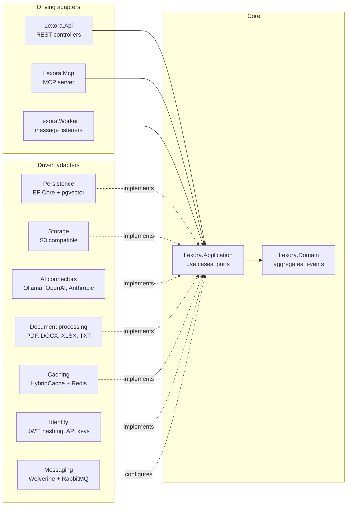

# Lexora

Knowledge platform where a company uploads its documents and talks to an AI that answers **only from that content**, with citations pointing to the exact document and page. The same knowledge is exposed to other agents and applications through an **MCP server**.

> Status: in development. See the roadmap section below.

## Highlights

- **RAG pipeline**: upload → text extraction → token-aware chunking → embeddings → hybrid search (pgvector + PostgreSQL full-text, fused with Reciprocal Rank Fusion) → grounded answer with citations.
- **Pluggable AI providers**: Ollama (local and free), OpenAI, Anthropic and any OpenAI-compatible endpoint, selected by configuration through named profiles. Chat and embedding providers are configured independently.
- **Hexagonal architecture + DDD**: the core (Domain + Application) has no dependency on frameworks for storage, AI or transport. Every adapter lives in its own project with its own `DependencyInjection.cs`.
- **CQRS with Wolverine**: in-process mediator for commands and queries, transactional outbox on PostgreSQL, RabbitMQ transport for the ingestion pipeline, durable inbox, retry policies and pre-generated handler code in production.
- **Built-in authentication**: JWT access tokens with rotating refresh tokens, PBKDF2 password hashing, account lockout, roles (Admin, Member, Viewer) and API keys for agents. The first admin is created by a seed command.
- **Explicit database migrations**: EF Core migrations are applied only by command, never at application startup.
- **MCP server** (Streamable HTTP) with tools to list knowledge bases, search documents and ask questions with citations.
- **Vue 3 front-end** with login, document upload with live status and streaming chat.
- Everything runs with **Docker Compose**.

## Architecture



## Tech stack

| Area | Technology |
|---|---|
| Runtime | .NET 10, C# 14 |
| Messaging / mediator | Wolverine (MIT), RabbitMQ |
| Database | PostgreSQL + pgvector, EF Core |
| Object storage | S3 API (SeaweedFS locally, any S3-compatible service in production) |
| Cache | HybridCache + Redis |
| AI | Microsoft.Extensions.AI, Ollama, OpenAI, Anthropic, OpenAI-compatible endpoints |
| Authentication | ASP.NET Core JWT Bearer, PBKDF2 password hashing, API keys |
| MCP | Official MCP C# SDK |
| Front-end | Vue 3, Vite, TypeScript, Pinia |
| Observability | OpenTelemetry, Serilog, Seq |
| Tests | xUnit v3, Shouldly, NSubstitute, Testcontainers |

## Getting started

Prerequisites: Docker, .NET 10 SDK, `dotnet-ef`, Node.js LTS.

### Docker

```bash
cp .env.example .env
docker compose --profile ai-local up -d --build
```

Fill `.env` first: `JWT_SIGNING_KEY` (generate one with `openssl rand -base64 64`), `SEED_ADMIN_EMAIL` and `SEED_ADMIN_PASSWORD` (at least 12 characters with upper and lower case letters and a number). The `migrator` service applies the EF Core migrations, sets up the messaging tables and creates the first admin before the API starts; running it again changes nothing.

The `ai-local` profile starts Ollama and downloads the embedding model (`OLLAMA_EMBEDDING_MODEL`, `bge-m3` by default, about 1.2 GB) and the chat model (`OLLAMA_CHAT_MODEL`, `qwen2.5:7b` by default, about 4.7 GB) before the worker starts. To run without a local model, set `AI_CHAT_PROFILE=fake` and `AI_EMBEDDING_PROFILE=fake` in `.env` and leave the profile out (`docker compose up -d --build`); the `fake` profiles give deterministic answers and vectors that are fine for trying the flow but useless for real search.

### AI profiles

Chat and embedding providers are named profiles under `Ai:Chat:Profiles` and `Ai:Embedding:Profiles` in `appsettings.json`: `local` (Ollama), `claude` (Anthropic), `openai`, `groq` (any OpenAI-compatible endpoint) and `fake`. The active ones are `Ai:Chat:DefaultProfile` and `Ai:Embedding:Profile` (`AI_CHAT_PROFILE` and `AI_EMBEDDING_PROFILE` in `.env`); switching providers is a configuration change. API keys never go into `appsettings.json`: use user secrets locally (`dotnet user-secrets set "Ai:Chat:Profiles:groq:ApiKey" "<key>" --project src/Hosts/Lexora.Api`) or `ANTHROPIC_API_KEY`, `OPENAI_API_KEY` and `GROQ_API_KEY` in `.env`.

The active profiles must be complete or the hosts do not start. Other chat profiles without their key stay listed as unavailable in `GET /api/v1/ai/profiles`. OpenAI-compatible profiles need a key unless they set `RequiresApiKey` to `false` (LM Studio, vLLM). Changing the embedding profile changes the vector space, so the knowledge bases must be reindexed (`POST /api/v1/knowledge-bases/{id}/reindex`, admin only), which sends every indexed document through the pipeline again.

The provider contract tests in `tests/Lexora.Infrastructure.IntegrationTests` call the real services when they can: Ollama when it answers at `localhost:11434` with the models pulled, and the paid or hosted ones when their key is in that project's user secrets (`dotnet user-secrets set "Ai:Chat:Profiles:groq:ApiKey" "<key>" --project tests/Lexora.Infrastructure.IntegrationTests`). Without them those tests are skipped.

| Service | URL |
|---|---|
| Web app | http://localhost:3000 |
| API (Swagger) | http://localhost:5080/swagger |
| Worker (health) | http://localhost:5081/health/ready |
| MCP server | http://localhost:5090/mcp |
| RabbitMQ | http://localhost:15672 |
| Seq | http://localhost:5341 |
| SeaweedFS (S3) | http://localhost:8333 |
| Ollama (`ai-local`) | http://localhost:11434 |

### Local (without the app containers)

```bash
dotnet user-secrets set "Jwt:SigningKey" "$(openssl rand -base64 64)" --project src/Hosts/Lexora.Api
dotnet user-secrets set "Seed:Admin:Email" "admin@lexora.local" --project src/Hosts/Lexora.Api
dotnet user-secrets set "Seed:Admin:Name" "Administrator" --project src/Hosts/Lexora.Api
dotnet user-secrets set "Seed:Admin:Password" "<a strong password>" --project src/Hosts/Lexora.Api
dotnet user-secrets set "Jwt:SigningKey" "$(openssl rand -base64 64)" --project src/Hosts/Lexora.Worker
for host in Api Worker; do
  dotnet user-secrets set "Storage:S3:AccessKey" "lexora" --project src/Hosts/Lexora.$host
  dotnet user-secrets set "Storage:S3:SecretKey" "lexora-local-secret" --project src/Hosts/Lexora.$host
done
```

```bash
docker compose up -d postgres rabbitmq redis seaweedfs seaweedfs-init seq
dotnet ef database update --project src/Infrastructure/Lexora.Infrastructure.Persistence --startup-project src/Hosts/Lexora.Api --context LexoraDbContext
dotnet run --project src/Hosts/Lexora.Api -- resources setup
dotnet run --project src/Hosts/Lexora.Api -- seed-admin
dotnet run --project src/Hosts/Lexora.Api
dotnet run --project src/Hosts/Lexora.Worker
```

Secrets stay in user secrets, never in `appsettings.json`: the JWT signing key (both hosts refuse to start without one of at least 32 bytes), the first admin's credentials and the S3 keys (the values above match the local SeaweedFS credentials in `deploy/seaweedfs/s3.json`). To keep files on disk instead of S3, set `Storage:Provider` to `Local` with `Storage:Local:RootPath` and `Storage:Local:DownloadBaseUrl` (for example `http://localhost:5080/api/v1/files/`). The next three commands apply the EF Core migrations, create the messaging tables and create the first admin. Swagger is available at `/swagger` in Development.

In Development both hosts use the `fake` chat and embedding profiles. To use real models, start Ollama with `docker compose --profile ai-local up -d ollama ollama-init` and run the hosts with `Ai__Chat__DefaultProfile=local` and `Ai__Embedding__Profile=local` (for example `Ai__Embedding__Profile=local dotnet run --project src/Hosts/Lexora.Worker`). Uploaded documents go through extraction, chunking and embedding in the worker until they reach `indexed`; `GET /api/v1/documents/{id}` shows the progress.

### Search and chat

`POST /api/v1/knowledge-bases/{id}/search` with `{ "query": "...", "mode": "hybrid", "topK": 8 }` returns the best excerpts of a knowledge base. The `hybrid` mode (the default) runs a vector search (pgvector HNSW, cosine) and a full-text search (PostgreSQL `portuguese` configuration) and fuses both rankings with Reciprocal Rank Fusion; `vector` and `keyword` run one side only. At most three excerpts per document are kept.

Questions are asked inside a conversation:

```bash
curl -X POST http://localhost:5080/api/v1/conversations -H "Authorization: Bearer <token>" -H "Content-Type: application/json" -d '{"knowledgeBaseId":"<id>"}'
curl -X POST http://localhost:5080/api/v1/conversations/<conversationId>/messages -H "Authorization: Bearer <token>" -H "Content-Type: application/json" -d '{"question":"What should be done in a chemical spill?"}'
curl -N -X POST http://localhost:5080/api/v1/conversations/<conversationId>/messages/stream -H "Authorization: Bearer <token>" -H "Content-Type: application/json" -d '{"question":"Who must be notified?"}'
```

The answer cites its sources as `[1]`, `[2]` and comes with the matching citations (document, page or sheet, excerpt). When nothing relevant is found the model is not called and the answer says so, with `grounded: false`. Follow-up questions are rewritten as standalone questions before the search. The streaming route sends server-sent events: `delta` with pieces of the text, then `citations`, then `done` (or `error`); the exchange is saved to the conversation only when the answer is complete. Each user can ask 20 questions per minute (`RateLimiting:Chat:PermitsPerMinute`); a provider outage answers 503 `ai.unavailable`.

Retrieval settings live in the `Rag` section (`CandidatePoolSize`, `MinVectorSimilarity`, `RrfK`, `MaxChunksPerDocument`, `TopK`, `MaxContextTokens`, `HistoryMessages`, `RewriteFollowUpQuestions`). Query embeddings are cached for an hour in HybridCache, with Redis as the second level when `ConnectionStrings:Redis` is set and memory only otherwise.

The prompts are Markdown templates in `src/Core/Lexora.Application/Conversations/Prompts/Templates`: the answer prompt (role, language, grounding, citation and output rules with short examples) and the follow-up rewrite prompt. Document excerpts, file names, questions and history are untrusted text: they go inside XML tags (`<documents>`, `<question>`, `<conversation>`), any of those tags inside the text is escaped so a document cannot close the context and add a fake question, and the rules are repeated after the context. The model has no tools, only sees excerpts of the conversation's knowledge base, and citations are rebuilt from the retrieved excerpts, never from the generated text. No prompt makes a model immune to prompt injection, so these layers limit what a malicious document can do: at most a wrong answer for whoever asked.

### Migrations

Migrations are managed with the `dotnet ef` CLI, from the repository root. Every command takes the same parameters:

```bash
EF="--project src/Infrastructure/Lexora.Infrastructure.Persistence --startup-project src/Hosts/Lexora.Api --context LexoraDbContext"

dotnet ef migrations add <MigrationName> --output-dir Migrations $EF
dotnet ef migrations list $EF
dotnet ef migrations remove $EF
dotnet ef database update $EF
dotnet ef migrations script --idempotent --output artifacts/migrations.sql $EF
dotnet ef migrations bundle --self-contained -r linux-x64 --output artifacts/efbundle --force $EF
```

`dotnet ef` builds the context through a design-time factory, so it does not start the application. It connects to `LEXORA_DESIGN_CONNECTION` when set, otherwise to the local Docker database.

## Project layout

```
src/
  Shared/          Lexora.Shared
  Core/            Lexora.Domain, Lexora.Application
  Infrastructure/  Lexora.Infrastructure.*
  Hosts/           Lexora.Api, Lexora.Worker, Lexora.Mcp
tests/
web/lexora-web/
deploy/
```

## Connecting an MCP client

Any MCP client that supports Streamable HTTP can connect to `http://localhost:5090/mcp` using an API key created by an admin (`Authorization: Bearer <api-key>`). For a quick test use the MCP Inspector:

```bash
npx @modelcontextprotocol/inspector
```

## Roadmap

- [x] Foundation and solution skeleton
- [x] Domain model
- [x] Persistence and migrations
- [x] Wolverine, authentication, admin seed and REST API
- [x] Storage and document upload
- [x] Ingestion pipeline
- [x] AI connectors
- [x] Hybrid search and chat with citations
- [ ] Vue front-end
- [ ] MCP server
- [ ] Observability and v1.0.0

## License

MIT
