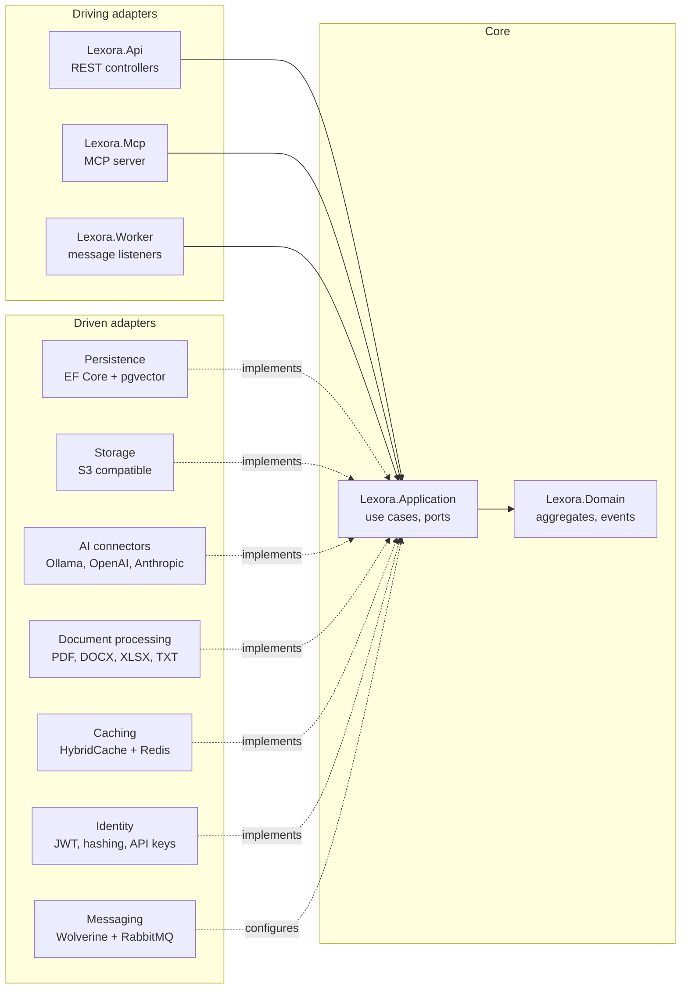

# Lexora

Knowledge platform where a company uploads its documents and talks to an AI that answers **only from that content**, with citations pointing to the exact document and page. The same knowledge is exposed to other agents and applications through an **MCP server**.

> Status: in development. See the roadmap section below.

## Highlights

- **RAG pipeline**: upload → text extraction → token-aware chunking → embeddings → hybrid search (pgvector + PostgreSQL full-text, fused with Reciprocal Rank Fusion) → grounded answer with citations.
- **Pluggable AI providers**: Ollama (local and free), OpenAI, Anthropic and any OpenAI-compatible endpoint, selected by configuration through named profiles. Chat and embedding providers are configured independently.
- **Hexagonal architecture + DDD**: the core (Domain + Application) has no dependency on frameworks for storage, AI or transport. Every adapter lives in its own project with its own `DependencyInjection.cs`.
- **CQRS with Wolverine**: in-process mediator for commands and queries, transactional outbox on PostgreSQL, RabbitMQ transport for the ingestion pipeline, durable inbox, retry policies and pre-generated handler code in production.
- **Built-in authentication**: JWT access tokens with rotating refresh tokens, PBKDF2 password hashing, account lockout, roles (Admin, Member, Viewer) and API keys for agents. The first admin is created by a seed command.
- **Explicit database migrations**: EF Core migrations are applied only by command, never at application startup.
- **MCP server** (Streamable HTTP) with tools to list knowledge bases, search documents and ask questions with citations.
- **Vue 3 front-end** with login, document upload with live status and streaming chat.
- Everything runs with **Docker Compose**.

## Architecture



## Tech stack

| Area | Technology |
|---|---|
| Runtime | .NET 10, C# 14 |
| Messaging / mediator | Wolverine (MIT), RabbitMQ |
| Database | PostgreSQL + pgvector, EF Core |
| Object storage | S3 API (SeaweedFS locally, any S3-compatible service in production) |
| Cache | HybridCache + Redis |
| AI | Microsoft.Extensions.AI, Ollama, OpenAI, Anthropic, OpenAI-compatible endpoints |
| Authentication | ASP.NET Core JWT Bearer, PBKDF2 password hashing, API keys |
| MCP | Official MCP C# SDK |
| Front-end | Vue 3, Vite, TypeScript, Pinia |
| Observability | OpenTelemetry, Serilog, Seq |
| Tests | xUnit v3, Shouldly, NSubstitute, Testcontainers |

## Getting started

Prerequisites: Docker, .NET 10 SDK, `dotnet-ef`, Node.js LTS.

### Docker

```bash
cp .env.example .env
docker compose up -d
docker compose --profile ai-local up -d
```

The `migrator` service applies the EF Core migrations and runs the admin seed before the API starts. Set `SEED_ADMIN_EMAIL` and `SEED_ADMIN_PASSWORD` in `.env` first.

| Service | URL |
|---|---|
| Web app | http://localhost:3000 |
| API (Swagger) | http://localhost:5080/swagger |
| MCP server | http://localhost:5090/mcp |
| RabbitMQ | http://localhost:15672 |
| Seq | http://localhost:5341 |

### Local (without the app containers)

```bash
docker compose up -d postgres rabbitmq redis seaweedfs seaweedfs-init seq
dotnet ef database update --project src/Infrastructure/Lexora.Infrastructure.Persistence --startup-project src/Hosts/Lexora.Api --context LexoraDbContext
dotnet run --project src/Hosts/Lexora.Api -- resources setup
dotnet run --project src/Hosts/Lexora.Api -- seed-admin
dotnet run --project src/Hosts/Lexora.Api
dotnet run --project src/Hosts/Lexora.Worker
```

The first three commands apply the EF Core migrations, create the messaging tables and create the first admin (credentials come from user secrets: `Seed:Admin:Email`, `Seed:Admin:Name`, `Seed:Admin:Password`).

### Migrations

Migrations are managed with the `dotnet ef` CLI, from the repository root. Every command takes the same parameters:

```bash
EF="--project src/Infrastructure/Lexora.Infrastructure.Persistence --startup-project src/Hosts/Lexora.Api --context LexoraDbContext"

dotnet ef migrations add <MigrationName> --output-dir Migrations $EF
dotnet ef migrations list $EF
dotnet ef migrations remove $EF
dotnet ef database update $EF
dotnet ef migrations script --idempotent --output artifacts/migrations.sql $EF
dotnet ef migrations bundle --self-contained -r linux-x64 --output artifacts/efbundle --force $EF
```

`dotnet ef` builds the context through a design-time factory, so it does not start the application. It connects to `LEXORA_DESIGN_CONNECTION` when set, otherwise to the local Docker database.

## Project layout

```
src/
  Shared/          Lexora.Shared
  Core/            Lexora.Domain, Lexora.Application
  Infrastructure/  Lexora.Infrastructure.*
  Hosts/           Lexora.Api, Lexora.Worker, Lexora.Mcp
tests/
web/lexora-web/
deploy/
```

## Connecting an MCP client

Any MCP client that supports Streamable HTTP can connect to `http://localhost:5090/mcp` using an API key created by an admin (`Authorization: Bearer <api-key>`). For a quick test use the MCP Inspector:

```bash
npx @modelcontextprotocol/inspector
```

## Roadmap

- [x] Foundation and solution skeleton
- [x] Domain model
- [x] Persistence and migrations
- [ ] Wolverine, authentication, admin seed and REST API
- [ ] Storage and document upload
- [ ] Ingestion pipeline
- [ ] AI connectors
- [ ] Hybrid search and chat with citations
- [ ] Vue front-end
- [ ] MCP server
- [ ] Observability and v1.0.0

## License

MIT
